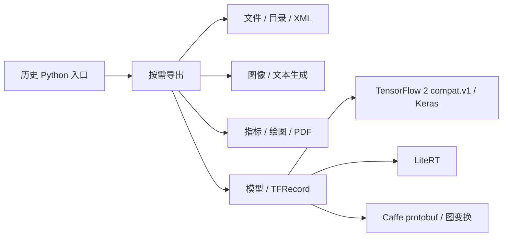

# 项目架构与边界

基线是 [review-manifest.json](review-manifest.json) 中的原始 revision；改造结果位于当前工作区。

| 能力 | 模块 | 输入/输出 | 外部依赖 |
|---|---|---|---|
| 文件与目录 | file, dir, decorator | 路径、文本、CSV、JSON、XML、XLS | lxml、NumPy；可选 xlwt |
| 图像与合成 | image, tools.text_generator | OpenCV/Pillow 数组和图片 | NumPy、Pillow、OpenCV |
| 评估与绘图/PDF | tools.metrics, plot_curve, pdf | 检测/分类文件，CSV、PNG/JPEG | 可选 matplotlib、PDFium |
| 数据与推理 | tensorflow.tools, tensorflow.lite | 数据批次、TFRecord、冻结图、Lite 模型 | TensorFlow 2 compatibility、LiteRT |
| 模型转换 | converters.taffe, caffe_tfmodel, tfmodel_lite | Caffe protobuf/weights → GraphDef → TFLite | protobuf、TensorFlow；图层子集 |
| 旧框架占位 | caffe, torch, trainer | 原有包路径 | 未实现训练器；不推断其有功能 |

关键链路：目录扫描→生成文件对→解析 XML→TFRecord；分类结果/标注→按图片对齐→指标 CSV；Caffe定义/权重→图形状/融合/转置→冻结图→Lite 转换→推理。每条链路有临时 fixture 或合成模型测试。

原 README 描述的训练网络大量是 TODO，占位代码不是实际产品能力。原测试使用个人目录且没有可运行的自动验证机制，属于文档/验证漂移。没有服务、数据库、租户、网络业务 API 或部署拓扑证据；不能推断生产 SLA。
